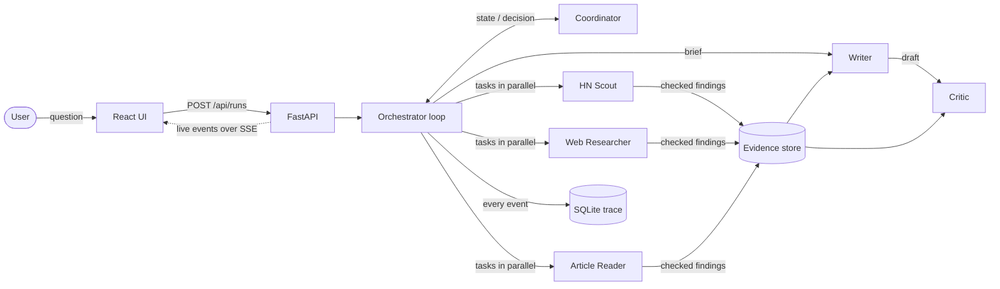

# Multi-Agent Researcher

[](https://github.com/Shreyanshsaboo/multi-agent-researcher-2/actions/workflows/ci.yml)

**Live demo: <https://multi-agent-researcher-cfbf.onrender.com>**

Six cooperating LLM agents that research a question across Hacker News and the web, read the most
important sources, and return a cited report that an independent critic has fact-checked. The run is
streamed live to a React interface, so you can watch the agents plan, delegate, retry and argue.

- **Dynamic orchestration.** A coordinator agent plans the research and decides every next step at
  run time. Nothing about the order of work is hard-coded.
- **Grounded output.** Every finding is checked against what the tools actually returned, every
  figure must appear in the retrieved text, and every claim in the report cites its source.
- **Writer–critic loop.** A critic on a different model family reviews each draft. The writer fixes
  or disputes each issue, and the coordinator settles disagreements.
- **Resilient by design.** Budgets, guardrails, fault injection, rate-limit routing across models and
  fallback paths mean every run ends with a result, even when agents or tools fail.
- **Fully traceable.** Every message, tool call and decision is an event. Runs persist in SQLite, and
  each one can be replayed or downloaded as a JSON trace.

## Contents

- [How it works](#how-it-works)
- [The agents](#the-agents)
- [Getting started](#getting-started)
- [Configuration](#configuration)
- [API](#api)
- [Development](#development)
- [Project structure](#project-structure)
- [Documentation](#documentation)
- [Known limitations](#known-limitations)
- [Team](#team)
- [License](#license)

## How it works



Each run is a loop. On every turn the **coordinator** reads a compact view of the run state (plan,
evidence index, task results, latest review) and returns one structured decision:

| Decision | What the orchestrator does |
|---|---|
| `delegate` | Runs 1–3 worker tasks in parallel. Each worker searches or reads with its own tools in a reasoning loop and reports findings, which are validated before they enter the shared evidence store. |
| `draft` | The writer drafts or revises the report from the evidence, then the critic reviews it against the evidence and an automated citation check. |
| `finish` | Accepts the latest reviewed draft. |
| `reject` | Declines a query that cannot be researched. |

The orchestrator holds no research strategy. It enforces the depth budget (turns, drafts, tasks,
time), corrects decisions that cannot be executed and tells the coordinator why, and falls back to a
default policy if the coordinator itself fails. The full design is in
[docs/design.md](docs/design.md).

## The agents

| Agent | Role | Model (default) | Tools |
|---|---|---|---|
| Coordinator | Plans sub-questions, delegates, re-plans after failures or critic feedback, decides when to stop | `openai/gpt-oss-120b` | none |
| HN Scout | Finds Hacker News stories and reads comment threads for practitioner opinion | `openai/gpt-oss-20b` | `search_hackernews`, `get_front_page`, `get_story_comments` |
| Web Researcher | Searches the web and news for facts, official sources and recent developments | `openai/gpt-oss-120b` | `web_search`, `news_search` |
| Article Reader | Reads the full text of the sources that matter most and extracts facts and figures | `openai/gpt-oss-20b` | `read_article` |
| Writer | Writes the cited report and revises it against the critic's issues, disputing the ones it disagrees with | `openai/gpt-oss-120b` | none |
| Critic | Fact-checks each draft against the evidence, rules on disputes, requests revisions or more research | `qwen/qwen3.8-27b` | none |

All models are served by [Groq](https://groq.com). Every agent can instead run on a local model
through [Ollama](https://ollama.com) (`LLM_PROVIDER=ollama`).

## Getting started

### Prerequisites

- Python 3.11 or later
- Node.js 20.19 or later (for the frontend)
- A Groq API key from [console.groq.com/keys](https://console.groq.com/keys). The free tier works,
  with the limits described under [Known limitations](#known-limitations).

```bash
git clone https://github.com/Shreyanshsaboo/multi-agent-researcher-2.git
cd multi-agent-researcher-2
cp .env.example .env        # then set GROQ_API_KEY in .env
```

### Run with Docker

One container serves the API and the built frontend on one port.

```bash
docker build -t multi-agent-researcher .
docker run --rm -p 8000:8000 --env-file .env -v researcher-data:/app/data multi-agent-researcher
```

Open <http://localhost:8000>.

### Deploy

[](https://render.com/deploy?repo=https://github.com/Shreyanshsaboo/multi-agent-researcher-2)

The repository includes a [Render blueprint](render.yaml) that builds the same container, and the
[live demo](https://multi-agent-researcher-cfbf.onrender.com) runs from it. Render asks for
`GROQ_API_KEY` when the service is created. The free plan stops a service after 15 idle minutes,
so a [scheduled workflow](.github/workflows/keep-warm.yml) checks its health every 10 minutes to keep
it responsive. The run history resets on each deploy. Any other host that runs a Dockerfile works
too: the container listens on `$PORT`.

### Run for development

Backend, from `backend/`:

```bash
python -m venv ../.venv && source ../.venv/bin/activate
pip install -r requirements-dev.txt
uvicorn app.main:app --reload            # http://localhost:8000
```

Frontend, from `frontend/` in a second terminal:

```bash
npm ci --include=dev
npm run dev                              # http://localhost:5173, proxies /api to :8000
```

### Run from the terminal

The CLI prints the agents' messages as they happen and can save the full trace:

```bash
cd backend
python -m app.cli "How are teams cutting LLM inference costs in 2026?" --depth quick --trace trace.json
python -m app.cli "..." --fail article_reader     # simulate an outage of one worker's tools
```

## Configuration

Settings are read from the environment, and from `.env` in the repository root during development.

| Variable | Default | Purpose |
|---|---|---|
| `GROQ_API_KEY` | none | Required for the hosted models |
| `LLM_PROVIDER` | `groq` | `groq`, or `ollama` to run every agent on a local model |
| `OLLAMA_HOST`, `OLLAMA_MODEL` | local daemon, `llama3.2` | Ollama connection and model |
| `MODEL_<AGENT>` | see [the agents](#the-agents) | Override one agent's model, e.g. `MODEL_WRITER=openai/gpt-oss-20b` |
| `LLM_TIMEOUT_S` | `60` | Timeout of a single model request |
| `AGENT_TIMEOUT_S` | `240` | Timeout of one agent's whole turn, including its tool loop |
| `MAX_ACTIVE_RUNS` | `2` | Runs allowed at once (they share the model rate limits) |
| `DB_PATH` | `backend/data/runs.db` | SQLite file for runs, events and conversations |

Each run has a depth, which sets its budget:

| Depth | Coordinator turns | Drafts | Parallel tasks per turn | Findings per task | URLs per read | Time limit |
|---|---|---|---|---|---|---|
| `quick` | 5 | 2 | 2 | 4 | 2 | 6 min |
| `standard` | 8 | 3 | 3 | 5 | 3 | 10 min |
| `deep` | 12 | 4 | 3 | 6 | 3 | 15 min |

## API

| Method and path | Description |
|---|---|
| `POST /api/runs` | Start a run: `{"query": "...", "options": {"depth": "quick"}, "thread_id": null}`. Returns `202` with `run_id` and `thread_id`. |
| `GET /api/runs/{id}/events` | Server-sent events: the run's trace, replayed from the start and then live. Resumes from `Last-Event-ID`. |
| `GET /api/runs/{id}` | The run and, once finished, its result |
| `GET /api/runs/{id}/trace` | The full event trace as a JSON download |
| `GET /api/runs/{id}/report.md` | The report as Markdown with its sources |
| `GET /api/runs` | Recent runs |
| `GET /api/threads`, `GET /api/threads/{id}` | Conversations: follow-up questions share a `thread_id` |
| `GET /api/agents` | The team, each agent's model and tools, and the depth budgets |
| `GET /api/health` | Liveness and whether a model is configured |

The request, result and event formats are specified, with real samples, in
[docs/io-spec.md](docs/io-spec.md). FastAPI also serves interactive docs at `/docs`.

## Development

```bash
# backend/
pytest                 # unit and API tests, with scripted agents (no API key or network needed)
ruff check .           # lint

# frontend/
npm test               # Vitest
npm run lint           # ESLint
npm run typecheck      # TypeScript, strict
npm run build          # production build into frontend/dist
```

CI runs all of these on every push and pull request
([.github/workflows/ci.yml](.github/workflows/ci.yml)), and checks that the Docker image builds.

## Project structure

```
.
├── backend/
│   ├── app/
│   │   ├── agents/          coordinator, workers, writer, critic, and the shared agent runtime
│   │   ├── tools/           Hacker News, web search and article tools, and their ToolContext
│   │   ├── orchestrator.py  the run loop: budgets, validation, delegation, write-and-review
│   │   ├── state.py         run state and how each agent sees it
│   │   ├── evidence.py      the shared evidence store and the citation check
│   │   ├── provider.py      rate-limit handling and routing across models
│   │   ├── events.py        the event channel, which is also the trace
│   │   ├── runner.py        starts runs in the background, conversation context
│   │   ├── store.py         SQLite persistence and long-term recall
│   │   ├── main.py          FastAPI app, SSE stream, serves the frontend
│   │   └── cli.py           terminal client
│   └── tests/               pytest suite and scripted fake agents
├── frontend/
│   └── src/
│       ├── components/      answer, live steps, agent graph, timeline, trace, review
│       └── lib/             event-sourced run state, SSE store, API client
├── docs/                    synopsis, design, input/output spec, three sample runs
├── prototype/               the v1 Streamlit prototype, kept for reference
├── Dockerfile
├── render.yaml              one-click deployment on Render
└── .env.example
```

## Documentation

| Document | Contents |
|---|---|
| [docs/synopsis.md](docs/synopsis.md) | The project in one page: problem, approach, outcome |
| [docs/design.md](docs/design.md) | Architecture, agent roles, orchestration pattern, communication, state and memory, guardrails, failure recovery, rate-limit strategy, technology choices |
| [docs/io-spec.md](docs/io-spec.md) | Input and output definitions: the run request, the result, the event trace, and what agents exchange |
| [docs/samples/](docs/samples/) | Three real captured runs, each with its trace, result and report |

## Known limitations

- **Speed on Groq's free tier.** Each model allows 8,000 tokens per minute, and qwen also caps output
  at 1,000 tokens per minute. A quick run uses 35–70K tokens across three models, so on the free tier
  it takes about two to three and a half minutes, most of it waiting for quota. The provider layer
  routes calls to whichever model has room, but cannot add capacity. A paid tier removes this.
- **Search quality.** Web and news search go through the keyless `ddgs` library, whose results
  for broad "latest news" questions are often stale or thin. The coordinator then spends turns on
  extra research.
- **Paywalls.** The article reader cannot read pages behind paywalls or bot protection. It reports
  those as failures, and the coordinator works around them.

## Team

Most of the system was built in joint working sessions and committed from one account, so the
commit history alone understates who did what. This table records each person's part.

| Member | GitHub | Contributions |
|---|---|---|
| Shreyansh Saboo (roll no. TODO) | [@Shreyanshsaboo](https://github.com/Shreyanshsaboo) | TODO |
| Raghav Dhoot (roll no. 23070122170) | [@dhootraghav](https://github.com/dhootraghav) | TODO |
| TODO (roll no. TODO) | [@dhruvgupta0603](https://github.com/dhruvgupta0603) | TODO |
| TODO (roll no. TODO) | [@sukaransingh123](https://github.com/sukaransingh123) | TODO |

## License

[Apache License 2.0](LICENSE).
