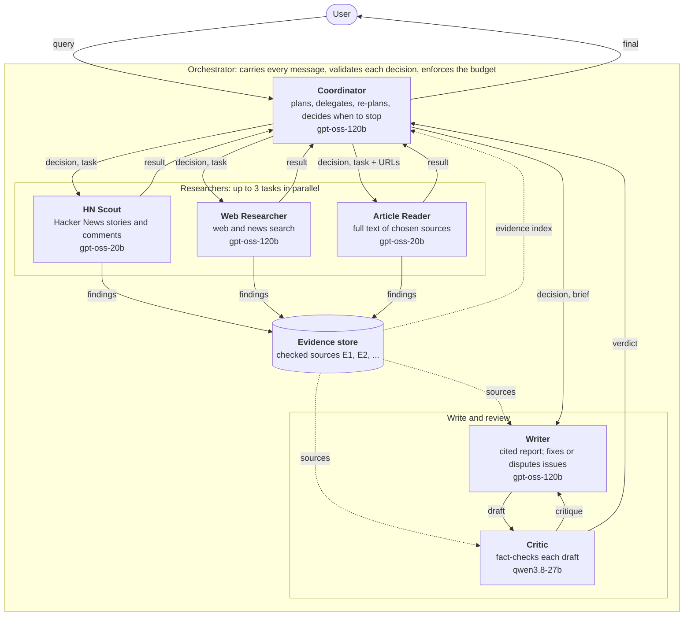
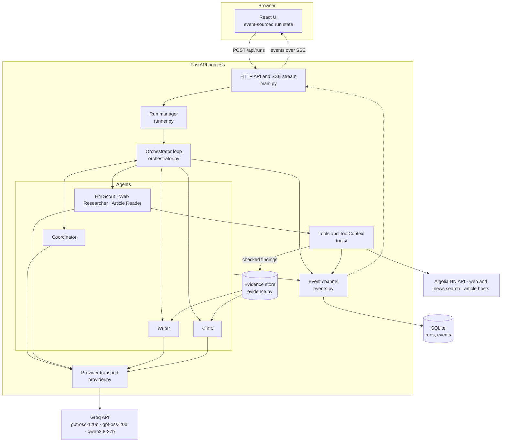
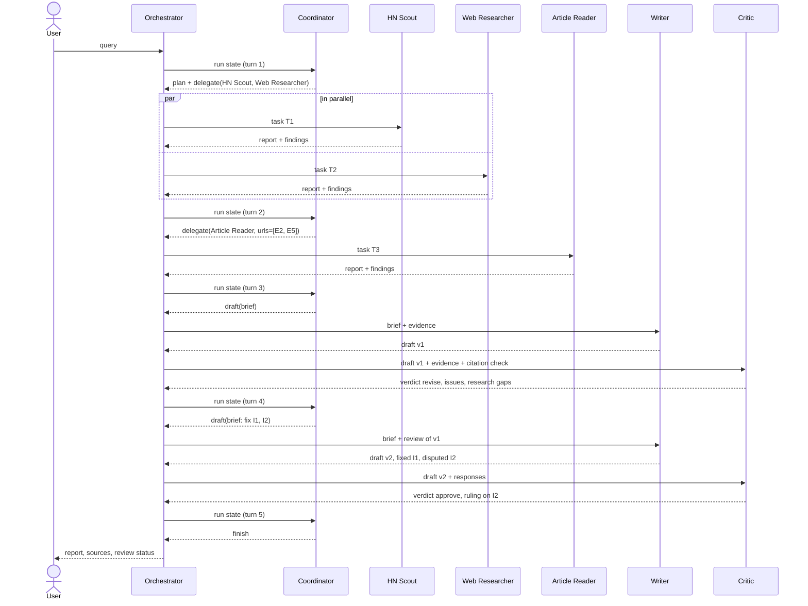

# Design

This document describes how the Multi-Agent Researcher is built and why. Every rule it states is
in the code; the module that implements it is named alongside. The request, result and event formats
are specified separately in [io-spec.md](io-spec.md), and [samples/](samples/) holds three real runs.

## Contents

1. [Goal](#1-goal)
2. [Architecture](#2-architecture)
3. [Agents and roles](#3-agents-and-roles)
4. [Orchestration pattern](#4-orchestration-pattern)
5. [Communication](#5-communication)
6. [State and memory](#6-state-and-memory)
7. [Guardrails](#7-guardrails)
8. [Failure handling and recovery](#8-failure-handling-and-recovery)
9. [Model access and rate limits](#9-model-access-and-rate-limits)
10. [Technology choices](#10-technology-choices)
11. [Testing](#11-testing)

## 1. Goal

Given an open research question, produce a short report that answers it from current sources,
cites every claim, and has been checked by a reviewer before the user sees it. Two kinds of source
matter: facts (official pages, news, articles) and practitioner opinion (Hacker News discussions).

A single agent with search, reading and writing tools tends to skip steps, lose track of sources and
state invented figures with confidence. This system instead divides the work among six agents with
narrow responsibilities. One agent decides the order of work at run time, every finding is checked
against what the tools really returned, and an independent reviewer gets the last word on quality.

## 2. Architecture

### Agents and the messages between them

Every agent, and every message that passes between them, in the direction it flows. Each solid
arrow between two agents, or between an agent and the user, is a `message` in the run's trace,
labelled with its kind (section 5). The `findings` arrows are `evidence` events, which add checked
sources to the shared evidence store, and dashed arrows are reads from it. The orchestrator carries
every message: it is code, not an agent, and it holds no research strategy (section 4).



| Flow | What travels |
|---|---|
| Coordinator → researchers | The decision that sends them (the coordinator's reasoning and updated plan), then a task: an instruction, the reason for it, and for the Article Reader the URLs or evidence ids to read |
| Researchers → Coordinator | A result: status, a short report, the evidence ids saved, errors |
| Researchers → evidence store | Findings that passed the source and figure checks (section 7) |
| Evidence store → Coordinator | A one-line-per-source index; the coordinator never sees raw tool output |
| Evidence store → Writer, Critic | Every source with its key points |
| Coordinator → Writer | The decision to draft, then a brief: what to write, or which issues to fix |
| Writer ↔ Critic | A draft with the writer's response to each earlier issue; the critic's issues back |
| Critic → Coordinator | A verdict, score and research requests, from which the coordinator re-plans |

### System components



| Layer | Module | Responsibility |
|---|---|---|
| Interface | `frontend/` | Asks questions, follows a run live over SSE, renders the answer, plan, sources, review, agent graph, timeline and trace |
| API | `app/main.py` | REST endpoints, the SSE event stream, trace and report downloads, serves the built frontend |
| Run management | `app/runner.py` | Starts each run as a background task with its own channel, evidence store, HTTP client and agents; caps concurrent runs; builds conversation context for follow-ups |
| Orchestration | `app/orchestrator.py` | The run loop: asks the coordinator for a decision, validates it, executes it, records the outcome |
| Agents | `app/agents/` | The six agents. Each wraps an [Agno](https://github.com/agno-agi/agno) agent with its own model, prompt, tools and output schema |
| Tools | `app/tools/` | Hacker News, web and news search, article reading. All calls go through `ToolContext`, which traces them and checks findings |
| Shared state | `app/state.py`, `app/evidence.py` | Working memory of a run, and the evidence store all agents read from |
| Model access | `app/llm.py`, `app/provider.py` | Builds each agent's model and fallbacks; manages rate limits below the SDK |
| Trace and persistence | `app/events.py`, `app/store.py` | Every event of a run, written to SQLite as it happens; long-term recall of past runs |

## 3. Agents and roles

| Agent | Kind | Responsibility | Sees | Produces | Model | Tools (call limit) |
|---|---|---|---|---|---|---|
| **Coordinator** | orchestrator | Breaks the query into sub-questions, chooses the next action, re-plans after failures or critic feedback, settles writer–critic disputes, decides when to stop | A compact rendering of the run state: plan, evidence index, task history, latest draft and review, budget left, related past research, orchestrator notes | `CoordinatorDecision` (JSON) | gpt-oss-120b | none |
| **HN Scout** | researcher | Finds relevant Hacker News stories and reads the most discussed comment threads, reporting opinions as opinions | Its task, the overall question, why the coordinator wants it | Worker report: status, summary, findings | gpt-oss-20b | `search_hackernews`, `get_front_page`, `get_story_comments` (4) |
| **Web Researcher** | researcher | Finds facts, official sources and recent developments through web and news search | Same as above | Worker report | gpt-oss-120b | `web_search`, `news_search` (3) |
| **Article Reader** | researcher | Reads the full text of the sources the coordinator picks and extracts facts, figures and quotes. Cannot search. | Same as above, plus the URLs to read | Worker report | gpt-oss-20b | `read_article` (3) |
| **Writer** | synthesis | Writes the cited report; on revision answers every critic issue as fixed or disputed with evidence | Query, plan, coordinator's brief, all evidence with key points; when revising, its previous draft and the critic's review | `WriterOutput` (JSON) | gpt-oss-120b | none |
| **Critic** | review | Checks each draft against the evidence for unsupported claims, citation errors, missing coverage, unacknowledged conflicts and clarity; rules on disputes; requests research for gaps | Query, plan, all evidence, the draft, an automated citation check, and its earlier issues with the writer's responses | `Critique` (JSON) | qwen3.8-27b | none |

Design rules behind the split:

- Each researcher has only the tools for its kind of source. A worker never has to choose between
  kinds of source; the coordinator makes that choice.
- The coordinator plans but never searches or writes, and never sees raw tool output. It routes on
  summaries and an evidence index, which keeps its context small.
- The critic runs on a different model family from the writer (qwen against gpt-oss), so the two do
  not share blind spots. When the critic's model is out of tokens it may only borrow models from
  other families (`Settings.alternate_models`).
- Up to three research tasks per turn run in parallel, each with its own `ToolContext`.

The agent prompts are in the agent modules: `coordinator.py`, `workers.py` (one shared protocol for
the three researchers, plus a specialty paragraph each), `writer.py` and `critic.py`.

## 4. Orchestration pattern

The system combines three patterns.

1. Supervisor and workers, with the plan made at run time. The coordinator, an LLM, decides every
   step from the current state. There is no fixed pipeline: the same code produces "HN and web in
   parallel, then read two articles, then draft" for one query and "draft immediately from earlier
   sources" for a follow-up such as "summarise that".
2. A blackboard. Researchers do not talk to each other. They write validated findings to a shared
   evidence store, and the writer and critic read from it. Findings for the same URL from different
   agents merge into one item.
3. A generator and critic loop. Every draft goes to the critic, and the coordinator decides whether
   to revise, research the gaps the critic named, or finish.

### The loop

```text
run(query):
    while budget not exhausted:
        turn += 1
        decision = coordinator.decide(state)        # falls back to a fixed policy if it fails
        decision = validate(decision)               # budget, evidence, URLs, repeats, last turn
        record decision and plan
        if delegate: run the tasks in parallel, record each TaskResult
        if draft:    writer drafts or revises; critic reviews with the citation check
        if finish or reject: stop
    on budget exhausted: make sure a draft exists, then stop
    return RunResult
```

The orchestrator (`Orchestrator.run`) holds no research strategy. It has four jobs: enforce the
budget, correct decisions that cannot be executed (and tell the coordinator why on its next turn),
execute decisions, and make sure every run ends with a result.

### An example run

The coordinator chooses the path each time, so runs differ. This one shows every agent and a
revision round. The [captured runs](samples/) took three other paths: one drafted straight after the
first research turn and then researched the critic's gaps, one sent the article reader to read two
sources in full before drafting, and one worked around a web search outage.



### Budgets

Each run has a depth (`quick`, `standard`, `deep`) that sets hard limits: coordinator turns, drafts,
parallel tasks per turn, findings per task, URLs per article read, and wall-clock time
(`config.BUDGETS`). The coordinator sees what is left on every turn and is told to draft or finish
when one or two turns remain. The time limit also holds inside a turn: a turn still running when
time is up is cancelled, and the writer gets two more minutes for a last draft before the run falls
back to the evidence digest.

## 5. Communication

### Messages

Agents communicate only through the orchestrator, and every exchange is recorded as a `message`
event with a sender, recipients, a kind, a one-line summary and the full structured content.

| Kind | From → to | Content |
|---|---|---|
| `query` | user → coordinator | The question |
| `decision` | coordinator → the agents it addresses | `CoordinatorDecision`, with the turn and whether the fallback policy made it |
| `task` | coordinator → a researcher | `TaskSpec` with its task id |
| `result` | researcher → coordinator | `TaskResult`: status, summary, evidence ids, tool calls, errors, duration |
| `brief` | coordinator → writer | What to write or fix |
| `draft` | writer → critic | Title, version, and the response to each earlier issue |
| `verdict` | critic → coordinator | `Critique`: verdict, score, issues, research requests, rulings |
| `critique` | critic → writer | The issues to address |
| `final` | coordinator → user | The outcome and review status |

### Structured outputs

The coordinator, writer and critic answer in JSON validated against Pydantic schemas
(`CoordinatorDecision`, `WriterOutput`, `Critique` in `schemas.py`). Enum-like fields are normalised
before validation (`"Delegate"` is accepted as `"delegate"`). A reply that still fails validation is
sent back once with the validation error (`run_structured`).

The researchers end with a plain-text report instead:

```text
STATUS: success | partial | failed
REPORT: 1-3 sentences on what was found, what failed, and what to do next
FINDING: <exact url from tool output>
TITLE: <short title>
- <key point>
```

Findings are text rather than a tool call because nested tool arguments are where smaller models
most often produce malformed JSON, and a malformed tool call fails the whole agent run. The parser
(`parse_report`) tolerates markdown and small format slips. Every finding is still validated
against the tool output before it is saved (section 7).

### The event channel is the trace

Everything that happens in a run is an event on its `RunChannel`: messages, agent status changes,
plans, tool calls, findings, token metrics, guardrail actions, rate-limit waits, model fallbacks,
drafts and reviews. Events are numbered, timestamped, written to SQLite as they are emitted, and
fanned out to live subscribers. The same list is the live UI feed, the replay of a finished run, and
the downloadable trace. The event types are listed in [io-spec.md](io-spec.md#3-the-event-trace).

## 6. State and memory

| Memory | Scope | Where | What it holds |
|---|---|---|---|
| Run state | one run | `state.RunState` | Plan, decisions, task results, drafts, reviews, orchestrator notes, budget and clock |
| Evidence store | one run | `evidence.EvidenceStore` | Sources keyed by normalised URL, with ids `E1, E2, …`, key points, who found them, whether the full text was read |
| Conversation | one thread | `runner.conversation_context` | For a follow-up: the last 3 completed turns' questions, answer summaries and up to 8 cited sources each |
| Long-term recall | all runs | `store.RunStore.recall` | Up to 2 completed past runs from other conversations whose question shares at least 2 keywords and a Jaccard similarity of at least 0.2 |
| Persistence | all runs | `store.RunStore` (SQLite, WAL) | Runs, results and every event |

Each agent sees a view of the run state shaped for its job (`RunState.render_*`). The coordinator
gets a one-line-per-source evidence index, the task history with summaries and errors, and the latest
review, but never raw tool output. The writer and critic get every source with its key points. The
researchers get only their own task.

For a follow-up, the cited sources of earlier answers are loaded into the new run's evidence store, so
"summarise that" can be answered without new research. Long-term recall is shown to the coordinator
as "related past research", and the URLs it lists may be given to the article reader.

At startup, runs still marked `running` are marked failed, since they died with the previous process
(`mark_interrupted`).

## 7. Guardrails

| Guardrail | Where | What it prevents |
|---|---|---|
| **Source must have been retrieved** (`unseen_source`) | `ToolContext._save` | A worker citing a URL none of its tools returned (an invented source) |
| **Figures must be in the source** (`ungrounded_figure`) | `ToolContext._save` | A key point whose numbers do not appear in the text the tool returned. The point is dropped |
| **Near-miss URLs** | `evidence.closest_url` | A long URL copied with a word missing being treated as unknown. Only near-identical URLs on the same site match |
| **Reader limited to known sources** | `read_article`, `Orchestrator._validate` | The article reader fetching URLs that are not in the evidence store or past research. Evidence ids such as `E3` are accepted |
| **Decision correction** (`decision_corrected`) | `Orchestrator._validate` | Drafting with no evidence, finishing with no draft, too many tasks, unreadable URLs, a task that repeats an earlier one, research on the last turn that could never reach the report. The coordinator is told what was changed and why |
| **Budget** (`budget`) | `Orchestrator._budget_exhausted`, `_wrap_up` | Runs that never end. On exhaustion the run stops and is guaranteed a draft |
| **Schema validation and retry** (`malformed_output`) | `runtime.run_structured` | Malformed JSON from the coordinator, writer or critic. The model is asked once more with the error |
| **Malformed tool call** (`malformed_tool_call`) | `provider.ResilientTransport` | A gpt-oss tool call Groq rejects as unparseable. The same request is resampled up to twice |
| **Citation check** | `evidence.check_citations` | Citing ids that do not exist, and substantive paragraphs with no citation. The result is given to the critic |
| **Critic independence** | `config.alternate_models` | The writer's model family reviewing its own draft |
| **Input validation** | `schemas.RunRequest` | Empty, oversized or non-text queries (3–500 characters, with at least a few letters or digits) |
| **Limits on tool output** | `tools/` | Context blow-up: article text is cut to the passages that match the reader's focus (3,200 characters), comments to 320 characters, search snippets to 220 |

## 8. Failure handling and recovery

| Failure | Handling | Visible in the trace as |
|---|---|---|
| A tool call fails (network, paywall, no results) | The tool returns an error string to the agent, which retries differently or reports it | `tool_call` with phase `failed` |
| A researcher fails, times out or returns an empty report | Sources its tools already retrieved are saved as raw evidence, the task is marked partial or failed, and the coordinator re-plans | `guardrail` rule `salvaged`, `result` with status `failed` |
| The coordinator fails | A fixed fallback policy takes over: research, then draft, then finish | `agent_error`, `decision` with `fallback: true` |
| The writer fails | A digest of the evidence is used as the draft, marked as not reviewed | `agent_error`, `draft` with `fallback: true` |
| The critic fails | The draft is kept and marked unreviewed | `agent_error`, `review` with an error |
| A model is out of tokens for the minute | The call moves to a team model with room, or waits exactly as long as needed | `model_fallback`, `rate_limited` |
| A model is out of its daily quota | It is skipped for the rest of the day | `model_fallback` |
| The run fails outright | The run is marked failed with the error | `run_failed` |

Failures can be injected on purpose. A run started with `simulate_failures` (in the UI under
Options, or `--fail` in the CLI) makes every tool call of the named researchers fail, and the
coordinator has to re-plan around the outage. In the [web search outage
sample](samples/sqlite-web-outage/), the web researcher failed on two turns; the coordinator then
sent the article reader to Hacker News threads and to sources recalled from earlier runs, and the
run still ended with a cited, reviewed report.

## 9. Model access and rate limits

All agents call Groq through one shared HTTP client whose transport (`provider.ResilientTransport`)
replaces the SDK's retries. On the free tier each model has its own per-minute token bucket (8,000
tokens; qwen also limits input to 7,000 and output to 1,000 tokens per minute), and one research run
needs 35–70K tokens. Three behaviours seen in live runs shaped the transport.

1. Groq charges a rejected request to the bucket anyway. Resending when the 429's `retry-after` says
   is therefore always rejected again, and an early version spent a researcher's whole timeout in
   that loop. The transport keeps its own estimate of each model's bucket from the rate-limit
   headers of every response and the figures in every 429, and only sends a request it expects to
   fit.
2. Each model has its own bucket. When an agent's own model has no room, the call goes to a team
   model that has room instead of waiting. All three models accept the same request parameters, so
   only the request's `model` changes. qwen lends to no one: its 1,000 output tokens a minute are
   kept for the critic, which can run on no other model, since it never borrows the writer's model
   family.
3. A daily quota resets only the next day, so the transport does not wait for it. A model past its
   daily quota is marked exhausted and skipped, and `llm.build_model_chain` gives every agent the
   team's other models as fallbacks.

Every reroute and wait is an event, and an agent's `metrics` event records which models served it.

## 10. Technology choices

| Choice | Why | Alternatives considered |
|---|---|---|
| **Agno** for agents | Tool-calling loops with call limits, structured output, per-agent model fallbacks, and async execution, without imposing an orchestration model. The orchestration is our own code, so it can be traced and tested | LangGraph (orchestration as a graph framework, more to learn and harder to trace step by step); Agno's own `Team` (used by the v1 prototype, but its delegation is opaque and could not be budgeted or validated) |
| **Groq** for inference | Fast enough for a live demo, a free tier, and several open model families behind one API | OpenAI (one family, so no independent critic, and no free tier); Ollama alone (supported, but small local models are slow and weak at planning) |
| **gpt-oss-120b, gpt-oss-20b, qwen3.8-27b** | The large model where judgement matters (coordinator, writer); the small one for bounded extraction (HN scout, article reader); a different family for the critic. The web researcher shares the large model because it runs in parallel with the HN scout and needs a rate-limit bucket of its own | One model for all six (simpler, but a single rate-limit bucket and no review independence) |
| **FastAPI + server-sent events** | Async end to end, Pydantic schemas shared with the agents, and SSE is one-directional, resumable with `Last-Event-ID`, and works through proxies | WebSockets (bidirectional, which is not needed, and no built-in resume) |
| **SQLite** | Zero operations, one file, transactional; the event table doubles as the trace store | Postgres (more to run for a single-node app) |
| **React 19, Vite, Tailwind** | An event-sourced client: one reducer (`runState.applyEvent`) turns the event stream into every view, live or replayed | Server-rendered pages (no live view of the agents) |
| **Algolia HN API** | Keyword search, date filters and a whole comment thread in one request | The official Firebase API (no search; one request per comment) |
| **ddgs** for web and news search | Keyless and free, rotating across several engines when one returns nothing | Paid search APIs (keys and cost for a course project) |
| **newspaper4k** for articles | Extracts the main text of most news sites cleanly | Raw HTML (navigation and ads would fill the context) |
| **One Docker container** | API and built frontend on one port, one thing to deploy | Separate frontend hosting (two deployments to keep in step) |

## 11. Testing

The backend suite (`backend/tests`, pytest) runs without an API key or network access:

- **Orchestration** with scripted fake agents (`tests/fakes.py`): routing, re-planning after a worker
  outage, the revision loop and disputes, coordinator and writer failures, budget stops, follow-ups,
  and the main decision corrections (unreadable URLs, repeated tasks, the last turn, drafting or
  finishing too early).
- **Tools** with mocked HTTP: result formatting, ad filtering, passage selection, and the source and
  figure checks on findings.
- **Provider** with a fake clock: the charged-rejection wait, routing to a model with room, output
  limits, daily quotas, and the borrowing rules.
- **Workers, store, events, runner and API**: report parsing, persistence and recall, event replay,
  the SSE stream and the endpoints.

The frontend tests (Vitest) cover the event reducer, the derived step list and citation
numbering. CI runs both suites
with their linters on every push, and builds the Docker image.
